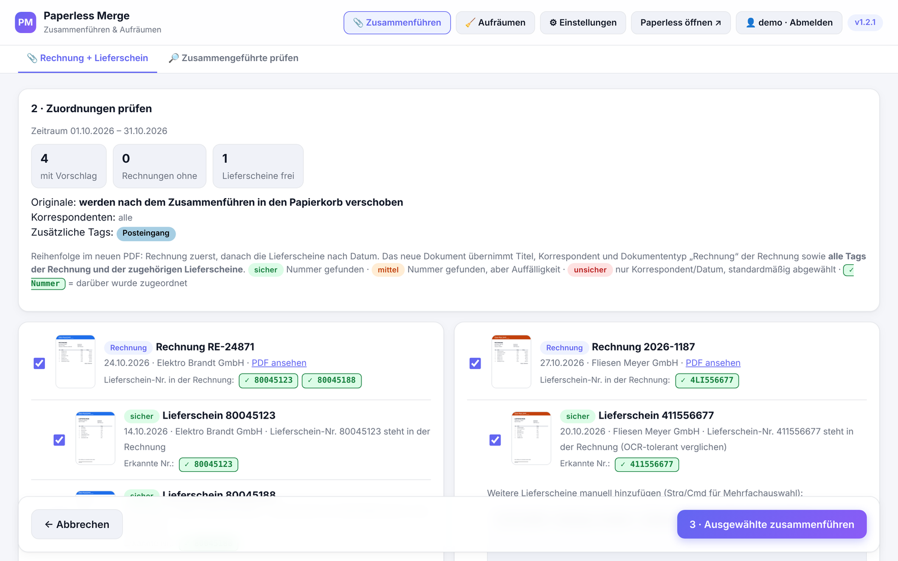
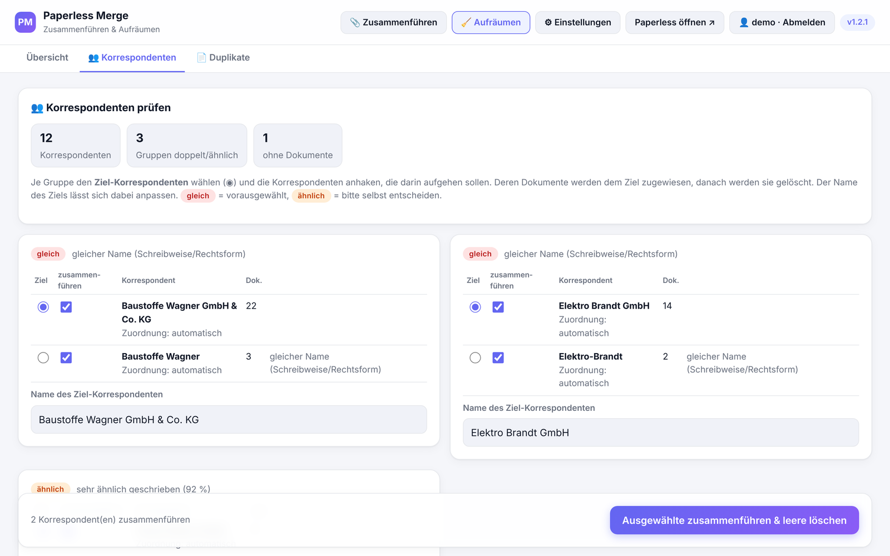
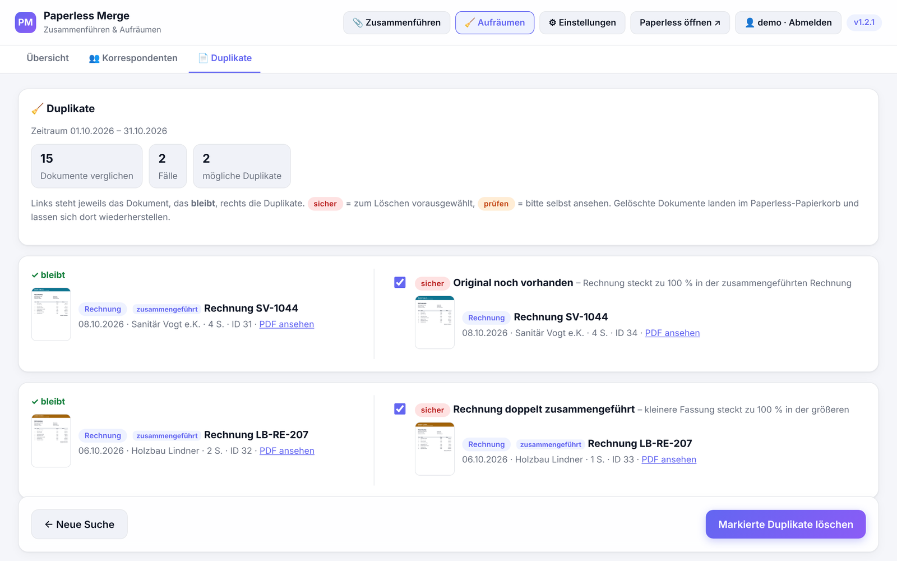
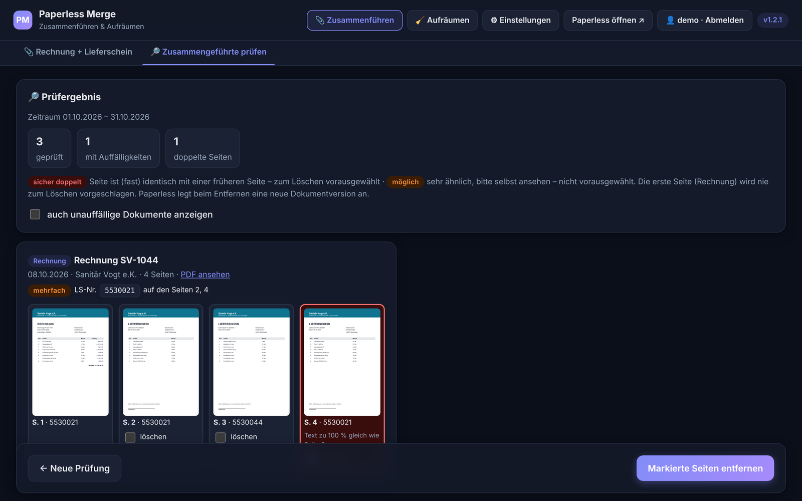
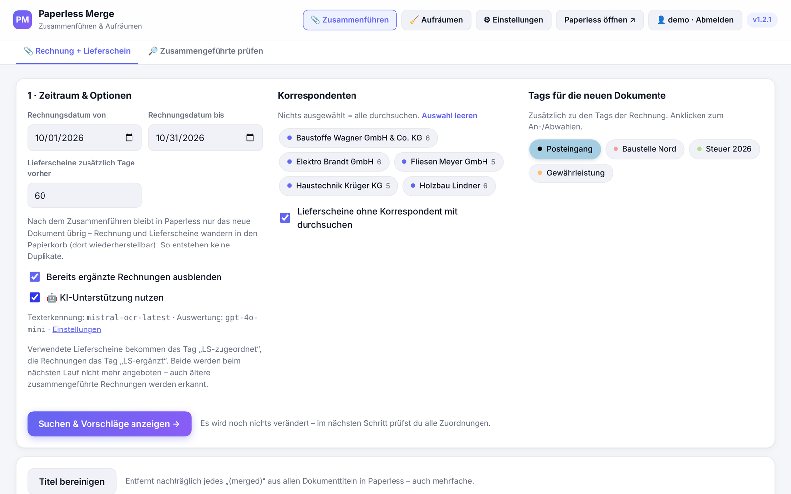
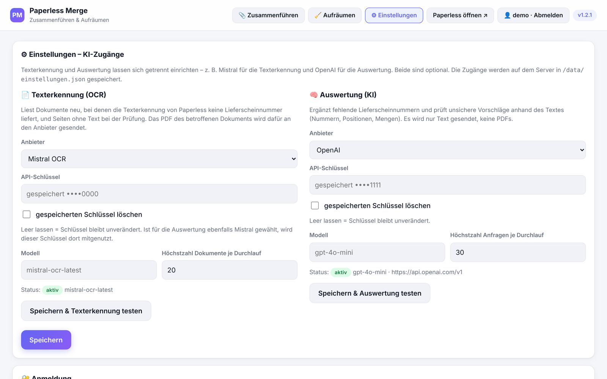
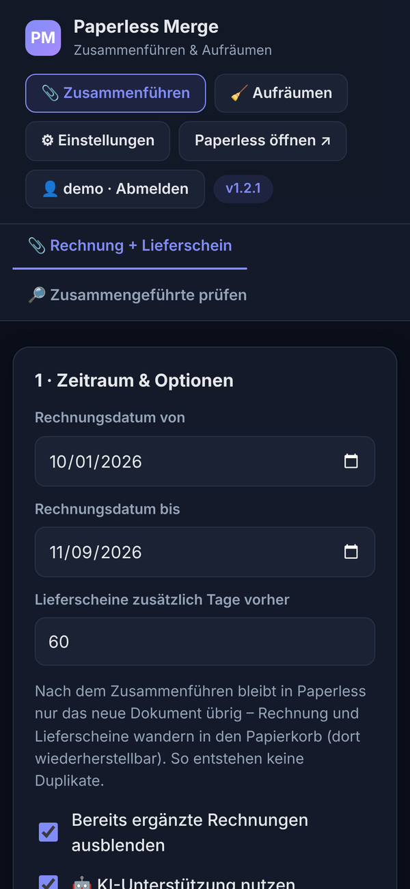

# paperless-merge

**Aktuelle Version: 1.2.1** · [Änderungen](#versionen)

Erweiterung für **Paperless-ngx** mit zwei getrennten Bereichen:

- **📎 Zusammenführen** – findet Rechnungen und die dazugehörigen Lieferscheine und führt sie zu **einem PDF** zusammen
- **🧹 Aufräumen** – hält den Bestand sauber: doppelte/ähnliche **Korrespondenten** zusammenführen und **doppelte Dokumente** entfernen

**Zusammenführen**

- **Rechnung immer als erste Seite**, danach die Lieferscheine nach Datum
- das neue Dokument läuft als Dokumententyp **Rechnung**, übernimmt Korrespondent und Speicherpfad der Rechnung
  sowie **alle Tags der Rechnung und der zugehörigen Lieferscheine**
- **nichts passiert ohne Kontrolle** – alle Zuordnungen werden vorher auf einer Prüfseite angezeigt
- **keine Duplikate** – nach jedem Durchlauf bleibt in Paperless jede Rechnung genau einmal übrig, mit jedem zugehörigen Lieferschein genau einmal darin
- frei wählbarer **Zeitraum**, Auswahl der **Korrespondenten** und der **Tags** für die neuen Dokumente
- OCR-tolerante Erkennung der Lieferscheinnummer (z. B. `LI` ↔ `11`)
- **Suche in der ganzen Paperless-Instanz** nach Rechnungen zu Lieferscheinen, die nicht zugeordnet werden konnten
- **Prüfung bereits zusammengeführter Rechnungen** auf doppelt enthaltene Lieferscheine – mit Seitenvorschau und Korrektur
- optionale **KI-Unterstützung**, in der Oberfläche einstellbar: **Texterkennung** (Mistral OCR) und **Auswertung** (OpenAI, Mistral oder andere OpenAI-kompatible API) – auch kombiniert

**Aufräumen**
- **Korrespondenten prüfen** – doppelte und ähnliche Korrespondenten (Schreibweisen, Rechtsformen, Tippfehler) finden, auf einen
  zusammenführen (alle Dokumente werden umgehängt, die leeren gelöscht) und unbenutzte entfernen
- **Duplikate prüfen** – doppelte Dokumente finden, nebeneinander ansehen und in den Papierkorb verschieben

Die Erweiterung läuft als eigener Docker-Container neben Paperless und arbeitet ausschließlich über
die Paperless-API. Paperless selbst wird nicht verändert.

## Bilder
*Alle Bilder zeigen frei erfundene Beispieldaten.*

| Prüfseite: Rechnung + Lieferschein | Korrespondenten aufräumen |
|---|---|
|  |  |
| **Duplikate prüfen** | **Zusammengeführte Rechnungen prüfen (Dark Mode)** |
|  |  |

<details><summary>Weitere Bilder: Startseite, KI-Einstellungen, Handy</summary>




</details>

---

## Inhalt
- [Bilder](#bilder)
- [Voraussetzungen](#voraussetzungen)
- [Installation](#installation)
- [Aktualisieren](#aktualisieren)
- [Anmeldung](#anmeldung)
- [Bedienung](#bedienung)
  - [1. Startseite](#1-startseite)
  - [2. Prüfseite](#2-prüfseite)
  - [3. Zusammenführen und Ergebnis](#3-zusammenführen-und-ergebnis)
  - [4. Rechnungen zu Lieferscheinen suchen](#4-rechnungen-zu-lieferscheinen-suchen)
  - [5. Zusammengeführte Rechnungen prüfen und korrigieren](#5-zusammengeführte-rechnungen-prüfen-und-korrigieren)
- [Aufräumen](#aufräumen)
  - [Korrespondenten prüfen und zusammenführen](#korrespondenten-prüfen-und-zusammenführen)
  - [Duplikate prüfen und löschen](#duplikate-prüfen-und-löschen)
- [KI-Unterstützung](#ki-unterstützung)
- [Was mit den Originalen passiert](#was-mit-den-originalen-passiert)
- [Wie die Zuordnung funktioniert](#wie-die-zuordnung-funktioniert)
- [Einstellungen](#einstellungen)
- [Fehlerbehebung](#fehlerbehebung)
- [Versionen](#versionen)

---

## Voraussetzungen
- Paperless-ngx Version 2.x oder 3.x mit den Dokumententypen **Rechnung** und **Lieferschein**
  (andere Namen über `DOCTYPE_INVOICE` / `DOCTYPE_DELIVERY` einstellbar)
- ein **API-Token**: in Paperless oben rechts auf das Profil → *API-Auth-Token*
- der Benutzer, zu dem der Token gehört, braucht Rechte zum **Anzeigen, Ändern, Hinzufügen und Löschen** von Dokumenten

## Installation
Das fertige Image liegt unter `ghcr.io/kaschperle8324/paperless-merge:latest` (amd64 + arm64).
Es wird nur eine `docker-compose.yml` benötigt – in Portainer einfach als neuen Stack einfügen:

```yaml
services:
  paperless-merge:
    image: ghcr.io/kaschperle8324/paperless-merge:latest
    container_name: paperless-merge
    restart: unless-stopped
    ports:
      - "8085:8080"
    environment:
      PAPERLESS_URL: "http://192.168.1.50:8000"   # Adresse von Paperless (IP:Port oder Containername)
      PAPERLESS_TOKEN: "HIER_TOKEN_EINTRAGEN"     # API-Auth-Token aus Paperless
      DEFAULT_TAGS: "Posteingang"                 # vorausgewählte Tags für neue Dokumente
      TZ: "Europe/Berlin"
    volumes:
      - ./data:/data                              # Einstellungen (KI-Zugänge) und Zwischenspeicher
```

`PAPERLESS_URL` und `PAPERLESS_TOKEN` anpassen und starten:

```bash
docker compose up -d
```

Aufruf im Browser: **`http://<server-ip>:8085`** – die laufende Version steht oben rechts in der Oberfläche.

Statt `latest` kann auch eine feste Version verwendet werden, z. B.
`ghcr.io/kaschperle8324/paperless-merge:0.3`. Dann wird erst aktualisiert, wenn die Versionsnummer
in der Compose-Datei geändert wird.

**Erster Aufruf:** Es erscheint das Fenster **„Willkommen – Zugang anlegen“**. Dort Benutzername und Passwort
(mindestens 8 Zeichen) festlegen – danach ist man direkt angemeldet. Siehe [Anmeldung](#anmeldung).

## Aktualisieren
```bash
docker compose pull && docker compose up -d
```
**Portainer:** *Stacks* → Stack öffnen → *Editor* → **Update the stack** → „Re-pull image and redeploy“ aktivieren → *Update*.
Danach die Seite im Browser mit **Strg + F5** neu laden. Ob die neue Version läuft, zeigt die
Versionsnummer oben rechts in der Oberfläche.

---

## Anmeldung
Die Oberfläche ist durch eine Anmeldung geschützt.

- **Erster Start:** Beim ersten Aufruf erscheint das Fenster *Willkommen – Zugang anlegen*. Benutzername (3–40 Zeichen)
  und Passwort (mindestens 8 Zeichen, zweimal eingeben) festlegen. Weitere Benutzer gibt es nicht.
- **Anmelden:** Benutzername (Groß-/Kleinschreibung egal) und Passwort. Mit *angemeldet bleiben* gilt die Anmeldung 30 Tage,
  sonst bis der Browser geschlossen wird. Nach der Anmeldung geht es zur ursprünglich aufgerufenen Seite weiter.
- **Abmelden:** Taste *👤 Benutzer · Abmelden* in der Kopfzeile.
- **Zugang ändern:** unter **⚙ Einstellungen → Anmeldung** – mit aktuellem Passwort; Benutzername optional. Danach müssen sich
  alle anderen Geräte neu anmelden.
- **Passwort vergessen:** Im Datenverzeichnis (`./data` neben der Compose-Datei) die Datei `benutzer.json` löschen.
  Beim nächsten Aufruf kann ein neuer Zugang angelegt werden; Einstellungen und KI-Zugänge bleiben erhalten.

**Sicherheit**
- Das Passwort wird nur als Hash (scrypt) in `/data/benutzer.json` gespeichert, die Datei ist nur für den Container lesbar.
- Nach 5 Fehlversuchen innerhalb von 10 Minuten wird die Anmeldung von dieser Adresse für 10 Minuten gesperrt.
- Der Schlüssel für die Anmelde-Sitzungen wird beim ersten Start erzeugt und in `/data/secret.key` abgelegt.
- Ohne das Volume `./data:/data` kann kein Zugang angelegt werden – das Einrichtungsfenster weist darauf hin.

**Alternativen**
- `APP_USER` / `APP_PASSWORD` in der Compose-Datei legen den Zugang fest vor; das Einrichtungsfenster entfällt und der Zugang
  ist in der Oberfläche nicht änderbar.
- `LOGIN_REQUIRED: "false"` schaltet die Anmeldung ab – nur sinnvoll, wenn ein vorgeschalteter Dienst wie Authentik
  oder ein Reverse-Proxy mit Anmeldung den Zugang schützt.

## Bedienung
Die Oberfläche nutzt die volle Bildschirmbreite, passt sich an Handy und Tablet an und schaltet
automatisch in den **Dark Mode**, wenn das Gerät dunkel eingestellt ist.

**Kopfzeile** (auf jeder Seite) – die beiden Hauptbereiche sind getrennt; der aktive ist hervorgehoben:
- **📎 Zusammenführen** – Bereich mit den Reitern *Rechnung + Lieferschein* (Startseite) und
  [*Zusammengeführte prüfen*](#5-zusammengeführte-rechnungen-prüfen-und-korrigieren). Ein Klick auf das Logo führt ebenfalls hierher.
- **🧹 Aufräumen** – Bereich mit den Reitern *Übersicht*, [*Korrespondenten*](#korrespondenten-prüfen-und-zusammenführen)
  und [*Duplikate*](#duplikate-prüfen-und-löschen).
- **⚙ Einstellungen** – [KI-Zugänge einrichten](#ki-unterstützung) und Zugang ändern.
- **Paperless öffnen ↗** – öffnet die Paperless-Instanz in einem neuen Tab. Verwendet wird `PAPERLESS_PUBLIC_URL`,
  wenn gesetzt, sonst `PAPERLESS_URL`. Steht in `PAPERLESS_URL` ein Containername (z. B. `http://paperless:8000`),
  den der Browser nicht kennt, `PAPERLESS_PUBLIC_URL` mit der Adresse setzen, unter der Paperless im Browser aufgerufen wird.
- **👤 Benutzer · Abmelden** – zeigt, wer angemeldet ist, und meldet ab.
- rechts die laufende **Versionsnummer**.

### 1. Startseite
Auf der Startseite werden nur Einstellungen getroffen – **es wird noch nichts verändert**.

**Zeitraum & Optionen**
| Feld | Bedeutung |
|---|---|
| Rechnungsdatum von / bis | Es werden Rechnungen mit Dokumentdatum in diesem Zeitraum gesucht. Vorbelegt: Anfang des Vormonats bis heute. |
| Lieferscheine zusätzlich Tage vorher | Lieferscheine liegen meist vor der Rechnung. Hier wird festgelegt, wie viele Tage vor dem Startdatum noch Lieferscheine berücksichtigt werden (Standard 60). |
| 🤖 KI-Unterstützung nutzen | Nur sichtbar, wenn Texterkennung oder Auswertung unter **⚙ Einstellungen** eingerichtet ist – siehe [KI-Unterstützung](#ki-unterstützung). Standard: an. |
| Bereits ergänzte Rechnungen ausblenden | Rechnungen, die schon mit Lieferscheinen zusammengeführt wurden, werden nicht erneut angeboten – siehe [Schutz vor doppeltem Zusammenführen](#schutz-vor-doppeltem-zusammenführen). Standard: an. |

**Korrespondenten**
- Alle Korrespondenten aus Paperless werden als anklickbare Felder mit der Anzahl ihrer Dokumente angezeigt.
- **Nichts ausgewählt = alle Korrespondenten** werden durchsucht.
- Ab mehr als 12 Einträgen erscheint ein **Suchfeld**; *Auswahl leeren* hebt alle Markierungen auf.
- **Lieferscheine ohne Korrespondent mit durchsuchen** (Standard: an): Lieferscheine, denen in Paperless
  kein Korrespondent zugeordnet ist, werden ebenfalls berücksichtigt und über ihre Nummer zugeordnet.

**Tags für die neuen Dokumente**
- Alle vorhandenen Paperless-Tags erscheinen in ihren Paperless-Farben.
- Die ausgewählten Tags bekommt das zusammengeführte Dokument **zusätzlich** zu den Tags, die Rechnung und
  Lieferscheine ohnehin schon haben (siehe [Tags des neuen Dokuments](#tags-des-neuen-dokuments)).
- Vorausgewählt sind die Tags aus `DEFAULT_TAGS` (Standard: *Posteingang*).
- Ab mehr als 12 Tags erscheint ein Suchfeld.

Mit **Suchen & Vorschläge anzeigen** geht es zur Prüfseite.

**Titel bereinigen** (unten auf der Startseite): entfernt jederzeit nachträglich jedes „(merged)“ aus allen
Dokumenttiteln in Paperless – auch mehrfache wie „Rechnung 4711 (merged) (merged)“. Vor dem Ausführen
kommt eine Sicherheitsabfrage.

### 2. Prüfseite
Oben steht eine Übersicht: Zeitraum, Anzahl der Rechnungen **mit Vorschlag**, Rechnungen **ohne**
gefundenen Lieferschein, **freie** Lieferscheine, ggf. **bereits ergänzte (ausgeblendete)** Rechnungen und
**schon enthaltene** Lieferscheine, gewählte Korrespondenten und zusätzliche Tags. Liegen in Paperless noch Originale, die schon
in einer zusammengeführten Rechnung stecken, weist ein Hinweis darauf hin (Aufräumen über *🧹 Aufräumen → Duplikate*).

Darunter steht jede Rechnung als eigene Karte (auf breiten Bildschirmen mehrere nebeneinander):
- **Vorschaubild** und Link **PDF ansehen** (bzw. *in Paperless öffnen*, wenn `PAPERLESS_PUBLIC_URL` gesetzt ist)
- Datum, Korrespondent und ggf. ASN
- **Lieferschein-Nr. in der Rechnung:** alle Lieferscheinnummern, die im Text der Rechnung gefunden wurden
- darunter die vorgeschlagenen Lieferscheine mit Bewertung und Begründung:

| Markierung | Bedeutung | Vorauswahl |
|---|---|---|
| 🟢 **sicher** | Lieferscheinnummer in der Rechnung gefunden (oder die Rechnung nennt eine Nummer, die im Lieferschein steht) – auch OCR-tolerant | angehakt |
| 🟠 **mittel** | Nummer gefunden, aber Rechnung und Lieferschein haben **unterschiedliche Korrespondenten** | angehakt – bitte prüfen |
| 🔴 **unsicher** | keine Nummer gefunden, nur gleicher Korrespondent und passendes Datum | **nicht** angehakt |

Bei jedem vorgeschlagenen Lieferschein steht außerdem **Erkannte Nr.:** – die Nummern, die im Lieferschein
erkannt wurden. Die Nummer, über die Rechnung und Lieferschein zugeordnet wurden, ist **grün mit ✓**
markiert, bei der Rechnung und beim Lieferschein. So ist auf einen Blick zu sehen:
- welche Nummer die Zuordnung ausgelöst hat (auch wenn sie OCR-bedingt unterschiedlich geschrieben ist, z. B. `4LI123456` ↔ `411123456`),
- welche Nummern in der Rechnung stehen, zu denen **kein** Lieferschein gefunden wurde (graue Nummer ohne ✓),
- bei welchen Lieferscheinen gar keine Nummer erkannt wurde (*keine erkannt*).

Auch in der Liste der nicht zugeordneten Lieferscheine und im Auswahlfeld zum manuellen Hinzufügen
stehen die erkannten Nummern.

**Lieferscheine, die schon in einer ergänzten Rechnung stecken**
Steht die Nummer eines Lieferscheins in einer Rechnung, die bereits mit Lieferscheinen zusammengeführt wurde
(z. B. ein doppelt eingescannter oder aus dem Papierkorb wiederhergestellter Lieferschein), wird er **nicht**
erneut vorgeschlagen. Er erscheint im eingeklappten Abschnitt *… stecken schon in einer ergänzten Rechnung*
mit Verweis auf die Rechnung. Mit **Ausgewählte als zugeordnet markieren** bekommt er das Tag `LS-zugeordnet`
und taucht künftig gar nicht mehr auf.

**Nicht zugeordnete Lieferscheine** können dort ebenfalls angehakt und mit **Ausgewählte als erledigt markieren**
dauerhaft ausgeschlossen werden – z. B. Lieferscheine, zu denen es nie eine Rechnung geben wird.

**Anpassen**
- Haken an der **Rechnung** entfernen → diese Rechnung wird nicht bearbeitet.
- Haken an einem **Lieferschein** entfernen → dieser Lieferschein bleibt außen vor.
- **Weitere Lieferscheine manuell hinzufügen:** Im Auswahlfeld unter jeder Rechnung stehen alle noch nicht
  zugeordneten Lieferscheine (Mehrfachauswahl mit Strg / Cmd). Das Anhaken eines Lieferscheins setzt
  automatisch auch den Haken an der Rechnung.
- **Rechnungen ohne gefundenen Lieferschein** und **nicht zugeordnete Lieferscheine** stehen eingeklappt
  am Ende der Seite – auch dort kann manuell zugeordnet werden.

Die Leiste mit **Abbrechen** und **Ausgewählte zusammenführen** bleibt beim Scrollen unten sichtbar.

### 3. Zusammenführen und Ergebnis
- Vor dem Ausführen kommt eine **Sicherheitsabfrage** mit der Anzahl der Rechnungen.
- Ist ein Lieferschein versehentlich **mehreren Rechnungen** zugeordnet, wird **nichts** ausgeführt und ein Hinweis angezeigt.
- Paperless erstellt die neuen PDFs im Hintergrund – sie erscheinen nach ein bis zwei Minuten.
- **Titelzusatz „(merged)“:** Paperless hängt beim Zusammenführen „(merged)“ an den Titel an. Das wird jetzt
  automatisch behandelt:
  - Enthält der Titel der Rechnung schon „(merged)“ (z. B. weil sie früher schon einmal zusammengeführt wurde),
    wird es **vorher entfernt** – der Zusatz kann sich so nicht stapeln.
  - Nach dem Zusammenführen entfernt die Erweiterung „(merged)“ **automatisch** aus den neuen Titeln, sobald
    Paperless die Dokumente angelegt hat (sie prüft dafür bis zu 5 Minuten im Hintergrund).
  - Zusätzlich gibt es auf der Ergebnisseite den Knopf **„(merged)“ jetzt aus allen Titeln entfernen** und auf der
    Startseite den Knopf **Titel bereinigen** für die nachträgliche Bereinigung.
- Ein Vorschlag ist **eine Stunde** gültig und kann nur **einmal** ausgeführt werden – danach neu suchen.

### 4. Rechnungen zu Lieferscheinen suchen
Lieferscheine, zu denen im gewählten Zeitraum keine Rechnung gefunden wurde, können gezielt in der
**ganzen Paperless-Instanz** gesucht werden – auch weit außerhalb des Zeitraums und auch in Dokumenten,
die schon einmal zusammengeführt wurden.

**Starten**
- Auf der Prüfseite unter **nicht zugeordnete Lieferscheine** die gewünschten Lieferscheine anhaken
  (*alle auswählen* markiert alle) und **🔍 Ausgewählte in Paperless suchen** klicken.
- Bei Lieferscheinen mit nur einem *unsicheren* Vorschlag steht direkt der Knopf **🔍 Rechnung in Paperless suchen**.

**Vorgaben** (vorbelegt mit den Werten aus der `docker-compose.yml`, siehe [Einstellungen](#einstellungen))
| Vorgabe | Bedeutung |
|---|---|
| Gesuchte Nummern | je Lieferschein vorbelegt mit den erkannten Nummern – **änderbar**, z. B. wenn die OCR die Nummer falsch gelesen hat. Mehrere Nummern mit Komma trennen. |
| Dokumententypen | in welchen Typen gesucht wird (Standard: *Rechnung*), z. B. zusätzlich *Gutschrift* |
| Tage vor / nach dem Lieferscheindatum | Zeitfenster rund um das Lieferscheindatum (Standard: 30 Tage vorher bis 365 Tage nachher) |
| ohne Zeitbegrenzung suchen | ignoriert das Zeitfenster und durchsucht alle Dokumente |
| nur beim gleichen Korrespondenten suchen | schränkt auf den Korrespondenten des Lieferscheins ein. Lieferscheine ohne Korrespondent werden immer bei allen gesucht. |

**Ergebnis**
- Für jeden Lieferschein werden die gefundenen Dokumente angezeigt – mit Typ, Datum, Korrespondent,
  Abstand zum Lieferscheindatum und der **gefundenen Nummer** (grün, ggf. mit Hinweis *OCR-tolerant*).
- Die Treffer sind nach Nähe zum Lieferscheindatum sortiert. Gibt es genau einen Treffer, ist er vorausgewählt,
  sonst steht die Auswahl auf *nicht zuordnen*.
- Vorgaben ändern und **Suchen** startet die Suche neu.
- **Ausgewählte zusammenführen** führt jeden Lieferschein mit dem gewählten Dokument zusammen – nach denselben
  Regeln wie oben: Rechnung zuerst, alle Tags, Originale in den Papierkorb, „(merged)“ wird bereinigt.
  Mehrere Lieferscheine zur selben Rechnung werden in einem Durchgang angehängt.
- Danach geht es mit **← Zurück zur Prüfseite** weiter; die zugeordneten Lieferscheine sind dort entfernt.
  Wurde eine Rechnung verwendet, die auch auf der Prüfseite steht, muss die Prüfseite neu erstellt werden.

### 5. Zusammengeführte Rechnungen prüfen und korrigieren
Im Bereich **📎 Zusammenführen** über den Reiter **🔎 Zusammengeführte prüfen** lassen sich alle Rechnungen kontrollieren, die schon mit Lieferscheinen
zusammengeführt wurden (Tag `LS-ergänzt` oder Paperless-Datei `…_merged.pdf` – auch direkt in Paperless
zusammengeführte Dokumente).

**Ablauf**
1. Zeitraum (Rechnungsdatum) wählen und **Prüfung starten**. Ist die Texterkennung eingerichtet, lässt sich
   *Seiten ohne Text mit der Texterkennung lesen* anhaken – dann werden auch Seiten ohne Textebene (reine Bild-Scans)
   per Text verglichen statt nur per Bild; solche Seiten sind mit **OCR** gekennzeichnet. Jede PDF wird einmal aus Paperless geladen und Seite für
   Seite untersucht; der Fortschritt wird angezeigt. Höchstens `AUDIT_MAX_DOCS` Dokumente je Prüfung (Standard 200, die neuesten zuerst).
2. Das **Prüfergebnis** zeigt nur Dokumente mit Auffälligkeiten (*auch unauffällige Dokumente anzeigen* blendet alle ein).
   Jede Seite erscheint als **Vorschaubild** mit den darauf erkannten Lieferscheinnummern.
3. Seiten, die entfernt werden sollen, anhaken und **Markierte Seiten entfernen** – nach einer Sicherheitsabfrage.

**Was erkannt wird**
| Hinweis | Bedeutung | Vorauswahl „löschen“ |
|---|---|---|
| 🟥 **sicher doppelt** | Seitentext zu mindestens 95 % gleich wie eine frühere Seite – derselbe Lieferschein ist zweimal enthalten (auch bei zweimal eingescanntem Papier) | angehakt |
| 🟧 **möglich** | Text zu 85–95 % ähnlich, oder Seite ohne Text, deren Bild einer früheren Seite nahezu gleicht | nicht angehakt – selbst ansehen |
| **mehrfach** | dieselbe Lieferscheinnummer auf nicht zusammenhängenden Seiten desselben Dokuments | – (nur Hinweis) |
| **auch woanders** | dieselbe Lieferscheinnummer steckt auch in einer **anderen** zusammengeführten Rechnung – mit Link und Seitenangabe | – (bei Bedarf die Seite im falschen Dokument anhaken) |

Behalten wird immer das **erste** Vorkommen. Die **erste Seite** (Rechnung) kann nicht gelöscht werden, und es bleibt immer
mindestens eine Seite übrig. Mehrseitige Lieferscheine (gleiche Nummer auf aufeinanderfolgenden Seiten) gelten nicht als doppelt.

**Korrektur:** Paperless entfernt die Seiten und legt das bereinigte Dokument im Hintergrund neu an (bei Paperless 3.x als neue
Version des Dokuments). Titel, Tags und alle anderen Angaben bleiben erhalten. Ein Dokument wird pro Prüfung nur einmal
korrigiert und danach mit *korrigiert* gekennzeichnet – für eine Kontrolle die Prüfung nach kurzer Zeit neu starten.

---

## Aufräumen
Der Bereich **🧹 Aufräumen** ist vom Zusammenführen getrennt und kann jederzeit unabhängig davon genutzt werden.
Vor jeder Änderung wird alles zur Kontrolle angezeigt.

### Korrespondenten prüfen und zusammenführen
Unter **🧹 Aufräumen → 👥 Korrespondenten** werden alle Korrespondenten aus Paperless verglichen.

**Was erkannt wird**
| Kennzeichen | Beispiel | Vorauswahl |
|---|---|---|
| 🟥 **gleich** – gleicher Name, nur andere Schreibweise oder Rechtsform | „Schäfer GmbH“ / „Schaefer GmbH“ / „SCHÄFER gmbh“, „Elektro Müller e.K.“ / „Elektro-Müller“ | angehakt |
| 🟧 **ähnlich** – Tippfehler | „Schäfer GmbH“ / „Schäffer GmbH“ | nicht angehakt |
| 🟧 **ähnlich** – Name im anderen enthalten | „Telekom“ / „Deutsche Telekom AG“ | nicht angehakt |

Beim Vergleich zählen Umlaute (ä = ae), Groß-/Kleinschreibung, Satzzeichen, Bindestriche und Rechtsformen (GmbH, KG,
& Co., AG, e.K., UG …) nicht. Allgemeine Wörter wie *Elektro*, *Bau*, *Stadtwerke* oder *Sparkasse* allein führen
nicht zu einem Treffer – „Stadtwerke Sontra“ und „Stadtwerke Eschwege“ bleiben getrennt.

**Ablauf**
1. Je Gruppe den **Ziel-Korrespondenten** wählen (◉, vorgewählt: der mit den meisten Dokumenten) und die Korrespondenten
   anhaken, die darin aufgehen sollen. Bei Bedarf den **Namen des Ziels** anpassen.
2. Optional unter **✋ Manuell zusammenführen** weitere Korrespondenten auswählen, die nicht automatisch erkannt wurden.
3. Optional unter **Korrespondenten ohne Dokumente** unbenutzte zum Löschen anhaken (nicht vorausgewählt – sie könnten in
   Mail-Regeln oder Workflows verwendet werden).
4. **Ausgewählte zusammenführen & leere löschen** – eine Zusammenfassung zeigt vorher genau, was passiert.

**Was passiert**
- Alle Dokumente der ausgewählten Korrespondenten werden dem Ziel zugewiesen.
- Danach wird geprüft, dass keiner mehr Dokumente hat – erst dann wird er gelöscht. Bleiben Dokumente übrig
  (z. B. fehlende Berechtigung), wird er nicht gelöscht und ein Hinweis angezeigt.
- Mit *Suchbegriffe … übernehmen* (Standard: an) werden die Suchbegriffe der gelöschten Korrespondenten in das Ziel übernommen,
  sofern beide die Zuordnung „irgendein Wort“ oder „alle Wörter“ verwenden.
- Der Name des Ziels wird zuletzt geändert – so kann es auch den Namen eines gelöschten Korrespondenten übernehmen.
- Ein Korrespondent kann nicht gleichzeitig Ziel und Quelle sein; widersprüchliche Auswahlen werden abgelehnt, ohne etwas zu ändern.

Hinweis: Gespeicherte Ansichten, Mail-Regeln oder Workflows in Paperless, die einen gelöschten Korrespondenten verwenden,
müssen danach ggf. auf das Ziel umgestellt werden.

### Duplikate prüfen und löschen
Unter **🧹 Aufräumen → 📄 Duplikate** lässt sich der Bestand in Paperless auf Duplikate prüfen – z. B. Reste aus
früheren Läufen oder doppelt eingescannte Belege.

1. Zeitraum (Dokumentdatum) und Dokumententypen wählen (vorausgewählt: *Rechnung* und *Lieferschein*) und
   **Duplikate suchen** – es wird noch nichts gelöscht.
2. Das Ergebnis zeigt je Fall **links das Dokument, das bleibt**, rechts die Duplikate – jeweils mit Vorschaubild,
   Datum, Korrespondent, Seitenzahl, ID und Link zum Ansehen.
3. Duplikate anhaken und **Markierte Duplikate löschen** – nach einer Sicherheitsabfrage wandern sie in den
   **Paperless-Papierkorb** (dort wiederherstellbar).

| Fall | Erkennung | bleibt | Vorauswahl |
|---|---|---|---|
| **Original noch vorhanden** | Rechnung oder Lieferschein steckt zu ≥ 80 % in einer zusammengeführten Rechnung | die zusammengeführte Rechnung | ab 90 % angehakt |
| **Rechnung doppelt zusammengeführt** | zwei zusammengeführte Fassungen sind gleich (≥ 90 %) oder die kleinere steckt in der größeren | die vollständigere Fassung | angehakt |
| **doppeltes Dokument** | zwei Dokumente desselben Typs mit ≥ 90 % gleichem Inhalt (z. B. doppelter Scan) | mehr Seiten, sonst mehr Tags, sonst das ältere | ab 95 % angehakt |
| **teilweise gleich – bitte prüfen** | zwei zusammengeführte Rechnungen mit derselben Rechnung, aber unterschiedlichen Lieferscheinen | – | nicht angehakt |

Verglichen wird der **Text** der Dokumente (Wortgruppen), unabhängig von Zeilenumbrüchen und typischen OCR-Fehlern.
Gemeinsame Briefköpfe, Bankverbindungen oder AGB zählen nicht als Übereinstimmung. Bei unterschiedlichen
Korrespondenten wird nie etwas vorausgewählt. Ein Dokument, das bleiben soll, kann nicht gelöscht werden.

## KI-Unterstützung
Optional können zwei KI-Dienste helfen – unabhängig voneinander, einzeln oder kombiniert:

| Dienst | Aufgabe | Anbieter | Was gesendet wird |
|---|---|---|---|
| 📄 **Texterkennung (OCR)** | liest Dokumente neu, bei denen die Paperless-Texterkennung keine Lieferscheinnummer liefert, und bei der Prüfung Seiten ohne Text | **Mistral OCR** | das **PDF** des betroffenen Dokuments |
| 🧠 **Auswertung (KI)** | ergänzt fehlende Lieferscheinnummern und prüft unsichere Vorschläge (Nummern, Positionen, Mengen) | **OpenAI**, **Mistral** oder jede andere OpenAI-kompatible API (z. B. lokal mit Ollama) | nur **Text**, gekürzt |

Bewährt hat sich: **Mistral für die Texterkennung, OpenAI für die Auswertung.** Beide werden beim jeweiligen Anbieter
nach Verbrauch abgerechnet (API-Schlüssel nötig).

### Einrichten in der Oberfläche
1. In der Kopfzeile **⚙ Einstellungen** öffnen.
2. **Texterkennung:** Anbieter *Mistral OCR* wählen, API-Schlüssel eintragen.
3. **Auswertung:** Anbieter wählen (*OpenAI*, *Mistral* oder *eigene Adresse*), Schlüssel eintragen. Das Modell kann leer
   bleiben – dann gilt `gpt-4o-mini` (OpenAI) bzw. `mistral-small-latest` (Mistral).
4. Mit **Speichern & … testen** wird jeder Zugang sofort geprüft; der Status zeigt *aktiv* oder *aus*.

Hinweise:
- Schlüssel werden nie vollständig angezeigt (nur die letzten 4 Zeichen). Ein leeres Schlüsselfeld lässt den gespeicherten
  Schlüssel unverändert; *gespeicherten Schlüssel löschen* entfernt ihn.
- Wird für beide Dienste Mistral verwendet, reicht **ein** Schlüssel – er wird automatisch mitgenutzt.
- Je Dienst lässt sich eine **Höchstzahl je Durchlauf** festlegen (Standard: 20 Dokumente Texterkennung, 30 Anfragen Auswertung).
- Gespeichert wird in `/data/einstellungen.json` (nur für den Container lesbar). Dafür muss das Volume `./data:/data`
  eingebunden sein – sonst zeigt die Einstellungsseite einen Hinweis.
- Die Seite ist wie die ganze Oberfläche nur nach [Anmeldung](#anmeldung) erreichbar.
- Die bisherigen Umgebungsvariablen (`AI_…`, `OCR_…`) funktionieren weiter und dienen als **Vorbelegung**, solange in der
  Oberfläche nichts gespeichert wurde.

### Was beim Durchlauf passiert
Ist auf der Startseite *KI-Unterstützung nutzen* angehakt:
1. **Texterkennung** (wenn eingerichtet): Lieferscheine ohne erkannte Nummer und Rechnungen ohne sicheren Lieferschein werden
   per Mistral OCR neu gelesen; im neuen Text sucht die normale Nummernerkennung. So gefundene Nummern sind mit **OCR** markiert.
2. **Auswertung – Nummern** (wenn eingerichtet): Findet auch das nichts, liest die KI die Lieferscheinnummern aus dem Text
   (Kennzeichen **KI**). Sie bekommt dabei den Paperless-Text **und** den OCR-Text.
3. **Auswertung – Vorschläge:** Jeden *unsicheren* Vorschlag vergleicht die KI inhaltlich. Ab 75 % Sicherheit wird er auf
   *sicher* gesetzt und angehakt, bei „passt nicht“ ab 60 % abgewählt; die Begründung steht beim Vorschlag (**🤖 KI**).

Oben auf der Prüfseite steht, wie viele Dokumente neu erkannt, Nummern ergänzt und Vorschläge geprüft wurden.

### Kosten und Datenschutz
- Beide Dienste werden nur dort gefragt, wo die normale Erkennung nicht weiterkommt, und sind je Durchlauf begrenzt.
- Die **Texterkennung** sendet das PDF des betroffenen Dokuments, die **Auswertung** nur Text (gekürzt auf `AI_MAX_CHARS`, Standard 6000 Zeichen).
- Ergebnisse beider Dienste werden in `/data/ki-cache.json` gespeichert – dasselbe Dokument wird nicht erneut abgerechnet.
- Wer keine Daten nach außen geben möchte, lässt die Texterkennung aus und trägt für die Auswertung ein lokales Modell ein
  (*eigene Adresse*, z. B. `http://192.168.1.60:11434/v1`).

## Was mit den Originalen passiert
Nach jedem Zusammenführen – egal ob von der Prüfseite oder aus der Lieferschein-Suche – bleibt in Paperless
**nur das neue Dokument** übrig: die Rechnung mit allen zugehörigen Lieferscheinen, jeder genau einmal.

| | danach |
|---|---|
| Original-Rechnung und -Lieferscheine | wandern in den **Paperless-Papierkorb** (dort wiederherstellbar). Paperless löscht sie erst, wenn das neue Dokument erfolgreich angelegt wurde. |
| Lieferscheine | bekommen vorher das Tag **`LS-zugeordnet`** – werden sie aus dem Papierkorb wiederhergestellt, werden sie trotzdem nicht erneut verwendet |
| neues Dokument | Typ *Rechnung*, Titel, Datum, Korrespondent, Speicherpfad und ASN der Rechnung, alle Tags (siehe unten) und das Tag **`LS-ergänzt`** |

### Tags des neuen Dokuments
Das zusammengeführte Dokument bekommt **alle Tags zusammen**:
1. die Tags der **Rechnung**,
2. die Tags **aller zugehörigen Lieferscheine**,
3. die auf der Startseite gewählten **Zusatz-Tags** (z. B. *Posteingang*).

Dazu kommt das Tag `LS-ergänzt` (siehe unten). Doppelte Tags werden nur einmal gesetzt. Das Tag `LS-zugeordnet` wird nie übernommen.
Technisch werden die Tags kurz vor dem Zusammenführen an die Rechnung gehängt, weil Paperless die
Metadaten des neuen Dokuments von der Rechnung übernimmt.

### Schutz vor doppeltem Zusammenführen
Damit eine Rechnung nicht bei jedem Lauf erneut mit ihren Lieferscheinen zusammengeführt wird, werden beim
Zusammenführen **immer** zwei Tags gesetzt (beide werden bei Bedarf automatisch angelegt):

| Tag | an | Wirkung beim nächsten Lauf |
|---|---|---|
| `LS-zugeordnet` | jedem verwendeten Lieferschein | Lieferschein wird nicht mehr gesucht |
| `LS-ergänzt` | der neuen Rechnung | Rechnung wird ausgeblendet |

Zusätzlich erkennt die Erweiterung auch **ältere** zusammengeführte Rechnungen ohne Tag – Paperless legt das
zusammengeführte PDF immer mit dem Dateinamen `…_merged.pdf` an. Das gilt auch für Dokumente, die direkt in
Paperless zusammengeführt wurden.

Außerdem wird der **Inhalt** verglichen: Eine Rechnung oder ein Lieferschein, dessen Text schon in einer
zusammengeführten Rechnung steckt (z. B. ein übrig gebliebenes Original), wird nicht erneut angeboten – auch ohne
Tag und ohne erkannte Nummer. Die Prüfseite weist dann auf *🧹 Aufräumen → Duplikate* hin.

Ausgeblendete Rechnungen werden trotzdem für die Zuordnung verwendet: Steht die Nummer eines Lieferscheins in
einer schon ergänzten Rechnung, wird dieser Lieferschein keiner anderen Rechnung zugeschlagen, sondern als
*schon enthalten* angezeigt. *Unsichere* Vorschläge (nur Korrespondent + Datum) gehen nie an ausgeblendete Rechnungen.

Soll an eine schon ergänzte Rechnung bewusst ein weiterer Lieferschein angehängt werden:
- auf der Startseite **Bereits ergänzte Rechnungen ausblenden** abschalten – die Rechnungen erscheinen dann mit dem
  Hinweis *bereits ergänzt*, oder
- den Lieferschein über [Rechnungen zu Lieferscheinen suchen](#4-rechnungen-zu-lieferscheinen-suchen) zuordnen –
  auch dort sind solche Rechnungen mit *bereits ergänzt* gekennzeichnet.

Um eine Rechnung oder einen Lieferschein wieder freizugeben, einfach das Tag in Paperless entfernen.

## Wie die Zuordnung funktioniert
1. **Nummern finden:** Im OCR-Text werden Nummern hinter Begriffen wie *Lieferschein*, *Lieferschein-Nr.*,
   *Lieferscheinnummer*, *LS-Nr.*, *Lieferung*, *Beleg-Nr.*, *Belegnummer* und *Delivery Note* gelesen.
   Hat ein Lieferschein keine solche Nummer, wird eine lange Ziffernfolge aus dem Titel verwendet.
2. **In beide Richtungen suchen:** Die Lieferscheinnummer wird in der Rechnung gesucht – und Nummern, die die
   Rechnung nennt, im Lieferschein. Führende Nullen werden ignoriert.
3. **OCR-tolerant:** Wird nichts gefunden, folgt ein zweiter Vergleich, der typische Texterkennungsfehler
   als gleich wertet: **L / I / | → 1**, **O / Q → 0**, **S → 5**, **B → 8**, **Z → 2**.
   So passt z. B. `4LI123456` zu `411123456`.
4. **Plausibilität:** Kurze Nummern (unter 5 Ziffern) zählen nur bei gleichem Korrespondenten.
   Unterschiedliche Korrespondenten stufen einen Treffer auf *mittel* herab.
5. **Rückfallebene:** Ohne Nummerntreffer wird ein Lieferschein desselben Korrespondenten vorgeschlagen,
   der bis zu `FALLBACK_DAYS` (Standard 45) Tage vor bis 3 Tage nach der Rechnung datiert ist – immer als *unsicher*.
6. **Bereits ergänzt:** Lieferscheine mit `LS-zugeordnet` werden gar nicht geladen. Rechnungen mit `LS-ergänzt`
   oder Dateiname `…_merged.pdf` werden nicht angeboten, binden aber Lieferscheine mit eindeutigem Nummerntreffer.
7. **Eindeutigkeit:** Jeder Lieferschein wird höchstens **einer** Rechnung zugeordnet – der mit dem besten
   Treffer bzw. dem nächstliegenden Datum. Dafür werden intern auch Rechnungen kurz vor und nach dem
   gewählten Zeitraum berücksichtigt, angezeigt werden aber nur Rechnungen aus dem Zeitraum.

---

## Einstellungen
Alle Einstellungen werden als Umgebungsvariablen in der `docker-compose.yml` gesetzt.

| Variable | Standard | Bedeutung |
|---|---|---|
| `PAPERLESS_URL` | `http://paperless:8000` | Adresse von Paperless aus Sicht des Containers (IP:Port oder Containername im selben Docker-Netz) |
| `PAPERLESS_TOKEN` | – | API-Auth-Token |
| `PAPERLESS_PUBLIC_URL` | leer | optional: Adresse, unter der Paperless im Browser erreichbar ist. Ziel der Taste *Paperless öffnen*; außerdem öffnen die Dokument-Links dann direkt in Paperless statt in der PDF-Ansicht |
| `DOCTYPE_INVOICE` | `Rechnung` | Name des Dokumententyps für Rechnungen |
| `DOCTYPE_DELIVERY` | `Lieferschein` | Name des Dokumententyps für Lieferscheine |
| `DEFAULT_TAGS` | `Posteingang` | vorausgewählte Tags für neue Dokumente, mehrere durch Komma getrennt |
| `DONE_TAG` | `LS-zugeordnet` | Tag für bereits verwendete Lieferscheine (wird bei Bedarf automatisch angelegt) |
| `MERGED_TAG` | `LS-ergänzt` | Tag für Rechnungen, an die Lieferscheine angehängt wurden (wird bei Bedarf automatisch angelegt) |
| `FALLBACK_DAYS` | `45` | Zeitfenster für *unsichere* Vorschläge: Lieferschein max. so viele Tage vor der Rechnung |
| `DEFAULT_LOOKBACK_DAYS` | `60` | Vorbelegung für „Lieferscheine zusätzlich Tage vorher“ |
| `VERIFY_SSL` | `true` | bei HTTPS mit selbstsigniertem Zertifikat auf `false` setzen |
| `SEARCH_DOCTYPES` | `Rechnung` | Suche zu Lieferscheinen: vorausgewählte Dokumententypen, kommagetrennt |
| `SEARCH_DAYS_BEFORE` | `30` | Suche zu Lieferscheinen: Tage vor dem Lieferscheindatum |
| `SEARCH_DAYS_AFTER` | `365` | Suche zu Lieferscheinen: Tage nach dem Lieferscheindatum |
| `SEARCH_UNLIMITED` | `false` | Suche zu Lieferscheinen: standardmäßig ohne Zeitbegrenzung |
| `SEARCH_SAME_CORR` | `true` | Suche zu Lieferscheinen: standardmäßig nur beim gleichen Korrespondenten |
| `AUDIT_MAX_DOCS` | `200` | Prüfung: höchstens so viele Dokumente je Prüfung |
| `DUP_MAX_DOCS` | `3000` | Duplikat-Prüfung: höchstens so viele Dokumente je Suche |
| `DATA_DIR` | `/data` | Datenverzeichnis für Einstellungen und Zwischenspeicher (als Volume einbinden) |

Die folgenden KI-Variablen sind **optional** – die Zugänge werden normalerweise unter **⚙ Einstellungen** gepflegt.
Gesetzte Variablen dienen als Vorbelegung, Werte aus der Oberfläche haben Vorrang.

| Variable | Standard | Bedeutung |
|---|---|---|
| `OCR_PROVIDER` | – | `mistral` schaltet die Texterkennung ein |
| `OCR_API_KEY` | leer | Schlüssel für die Texterkennung |
| `OCR_MODEL` | `mistral-ocr-latest` | Modell der Texterkennung |
| `OCR_MAX_CALLS` | `20` | höchstens so viele Dokumente je Durchlauf per Texterkennung |
| `AI_PROVIDER` | `openai` | Auswertung: `openai` oder `mistral` (setzt Adresse und Standardmodell) |
| `AI_API_KEY` | leer | Schlüssel für die Auswertung – ohne Schlüssel ist die Auswertung aus |
| `AI_MODEL` | je Anbieter | Modellname, Standard `gpt-4o-mini` (OpenAI) bzw. `mistral-small-latest` (Mistral) |
| `AI_BASE_URL` | je Anbieter | eigene Adresse einer OpenAI-kompatiblen API, z. B. `http://192.168.1.60:11434/v1` für Ollama |
| `AI_ENABLED` | – | `true` schaltet die KI auch ohne Schlüssel ein (für lokale Modelle) |
| `AI_MAX_CALLS` | `30` | höchstens so viele KI-Anfragen je Durchlauf |
| `AI_MAX_CHARS` | `6000` | so viele Zeichen Text je Dokument gehen an die KI |
| `AI_TIMEOUT` | `60` | Zeitlimit je KI-Anfrage in Sekunden |
| `AI_CACHE_FILE` | `/data/ki-cache.json` | Zwischenspeicher für Ergebnisse von Texterkennung und Auswertung |
| `SETTINGS_FILE` | `/data/einstellungen.json` | Datei, in der die Einstellungen aus der Oberfläche gespeichert werden |
| `AUTO_CLEAN_TITLES` | `true` | „(merged)“ nach dem Zusammenführen automatisch aus den Titeln entfernen |
| `APP_USER` / `APP_PASSWORD` | leer | Zugang fest vorgeben (beide setzen) – statt ihn beim ersten Start in der Oberfläche anzulegen |
| `LOGIN_REQUIRED` | `true` | `false` schaltet die Anmeldung ab (nur hinter Authentik o. Ä.) |
| `SECRET_KEY` | automatisch | Schlüssel für die Anmelde-Sitzungen; ohne Angabe wird er erzeugt und in `/data/secret.key` gespeichert |
| `USERS_FILE` | `/data/benutzer.json` | Datei mit dem angelegten Zugang |
| `TZ` | – | Zeitzone, z. B. `Europe/Berlin` |

---

## Fehlerbehebung
| Meldung / Problem | Ursache und Lösung |
|---|---|
| *Dokumententyp „Rechnung“ oder „Lieferschein“ nicht gefunden* | Die Namen müssen exakt wie in Paperless lauten – sonst `DOCTYPE_INVOICE` / `DOCTYPE_DELIVERY` anpassen. |
| *Fehler bei der Abfrage von Paperless* (Verbindungsfehler) | `PAPERLESS_URL` prüfen. Am einfachsten die IP mit Port eintragen, z. B. `http://192.168.1.50:8000`. |
| *HTTP 401* oder *403* | Token falsch oder dem Benutzer fehlen Rechte. |
| *Tags/Korrespondenten konnten nicht geladen werden* | wie oben – Verbindung oder Token prüfen. |
| Neue Dokumente erscheinen nicht | Paperless verarbeitet im Hintergrund – kurz warten. Bei Problemen in Paperless unter *Dateiaufgaben* nachsehen. |
| Lieferscheine werden nicht gefunden | Prüfen, ob die Nummer im OCR-Text (Paperless → Dokument → *Inhalt*) hinter einem der oben genannten Begriffe steht. Bessere Erkennung: mit 300 dpi scannen, `PAPERLESS_OCR_LANGUAGE: deu` setzen, Dokument in Paperless *erneut verarbeiten*. |
| Vorschlag „abgelaufen“ | Vorschläge gelten eine Stunde und nur für einen Lauf – einfach neu suchen. |
| *… fehlgeschlagen* – HTTP 401 (Einstellungen) | API-Schlüssel falsch oder beim Anbieter nicht freigeschaltet. |
| *Speichern nicht möglich* / *Verzeichnis nicht beschreibbar* | Volume `./data:/data` in der `docker-compose.yml` einbinden und Container neu starten. |
| *… fehlgeschlagen* – HTTP 404 / Modell unbekannt | Modellname unter ⚙ Einstellungen prüfen – er muss genau so beim Anbieter existieren. |
| *Höchstzahl an Anfragen erreicht* | Höchstzahl unter ⚙ Einstellungen erhöhen oder den Zeitraum verkleinern. |
| Prüfung meldet *Konnte nicht geprüft werden* | Die PDF des Dokuments ließ sich nicht laden oder lesen – Dokument in Paperless öffnen und ggf. *erneut verarbeiten*. |
| Passwort vergessen | `benutzer.json` im Datenverzeichnis löschen und die Seite neu aufrufen – dann einen neuen Zugang anlegen. |
| *Zu viele Fehlversuche* | 10 Minuten warten. |
| Nach jedem Neustart abgemeldet | Das Volume `./data:/data` fehlt – dann wird der Sitzungsschlüssel nicht gespeichert. |
| Duplikate aus früheren Versionen (Original und zusammengeführte Fassung) | Mit **🧹 Aufräumen → Duplikate** suchen und löschen. Seit Version 1.1 entstehen keine neuen mehr. |
| Alte Oberfläche nach Update | Browser-Cache: Seite mit **Strg + F5** neu laden. |

## Versionen
Die Versionsnummer steht in der Datei `VERSION`, oben rechts in der Oberfläche, im Image-Tag
(`ghcr.io/kaschperle8324/paperless-merge:<version>`) und als Release auf GitHub.

### Version 1.2.1 (09.11.2026)
- Fehlerbehebung: Die PDF-Bibliothek für Seitenvorschauen ist nicht threadsicher. Wurden während einer Prüfung gleichzeitig mehrere Seitenbilder geladen, konnte der Container abstürzen. Die Zugriffe laufen jetzt nacheinander.

### Version 1.2 (09.11.2026)
- Oberfläche in zwei getrennte Bereiche aufgeteilt: **📎 Zusammenführen** (Rechnung + Lieferschein, Zusammengeführte prüfen) und **🧹 Aufräumen** (Übersicht, Korrespondenten, Duplikate) – jeweils mit Reitern
- neue Funktion **Korrespondenten prüfen**: doppelte und ähnliche Korrespondenten finden (Schreibweise, Rechtsform, Tippfehler, enthaltener Name), Ziel wählen, Dokumente umhängen, leere Korrespondenten löschen, Ziel umbenennen
- manuelles Zusammenführen beliebiger Korrespondenten und Löschen unbenutzter Korrespondenten
- Suchbegriffe gelöschter Korrespondenten werden ins Ziel übernommen
- Kopfzeile neu: *Paperless Merge – Zusammenführen & Aufräumen*

### Version 1.1 (05.11.2026)
- **keine Duplikate mehr:** nach jedem Zusammenführen bleibt in Paperless je Rechnung genau ein Dokument übrig – die Originale gehen immer in den Papierkorb; die Option *Originale behalten* (Ursache der bisherigen Duplikate) entfällt
- Rechnungen und Lieferscheine, deren Inhalt schon in einer zusammengeführten Rechnung steckt, werden nicht erneut angeboten (Inhaltsvergleich zusätzlich zu Tags und Dateinamen)
- neue Funktion **🧹 Duplikate**: Bestand auf Duplikate prüfen (Originale neben zusammengeführten Rechnungen, doppelt zusammengeführte Rechnungen, doppelte Scans), nebeneinander ansehen und in den Papierkorb verschieben
- Löschen über die Paperless-API in den Papierkorb (Paperless 2.x und 3.x)

### Version 0.11 (05.11.2026)
- **Anmeldung** für die Oberfläche: beim ersten Aufruf Fenster zum Anlegen von Benutzer und Passwort, danach Anmeldeseite mit *angemeldet bleiben*
- Abmelden über die Kopfzeile, Zugang (Benutzername/Passwort) unter ⚙ Einstellungen änderbar
- Passwort nur als Hash gespeichert, Sperre nach 5 Fehlversuchen, Sitzungsschlüssel in `/data`
- `APP_USER` / `APP_PASSWORD` legen den Zugang weiterhin fest vor (jetzt mit Anmeldeseite statt Browser-Fenster); `LOGIN_REQUIRED=false` für den Betrieb hinter Authentik o. Ä.

### Version 0.10 (05.11.2026)
- neue Seite **⚙ Einstellungen**: KI-Zugänge direkt in der Oberfläche einrichten, mit Statusanzeige und Test-Knopf je Dienst; Schlüssel werden maskiert angezeigt
- KI aufgeteilt in **Texterkennung** (Mistral OCR) und **Auswertung** (OpenAI, Mistral oder eigene Adresse) – getrennt oder kombiniert nutzbar, z. B. Mistral für die Texterkennung und OpenAI für die Auswertung
- Texterkennung liest Lieferscheine ohne erkannte Nummer und schwache Rechnungen neu; gefundene Nummern sind mit **OCR** markiert
- Prüfung zusammengeführter Rechnungen kann Seiten ohne Text per Texterkennung lesen
- ein Mistral-Schlüssel genügt, wenn beide Dienste Mistral nutzen
- Umgebungsvariablen bleiben als Vorbelegung erhalten

### Version 0.9 (05.11.2026)
- neue Funktion **Zusammengeführte Rechnungen prüfen** (Taste 🔎 Prüfen): erkennt doppelt enthaltene Seiten per Text- und Bildvergleich, dieselbe Lieferscheinnummer mehrfach im Dokument und in mehreren Rechnungen; Seitenvorschau aller Seiten
- Korrektur direkt aus dem Prüfergebnis: markierte Seiten werden in Paperless entfernt (erste Seite geschützt)
- optionale **KI-Unterstützung** über eine OpenAI-kompatible API (OpenAI, Mistral oder eigene Adresse): ergänzt fehlende Lieferscheinnummern und prüft unsichere Vorschläge; Anfragen-Begrenzung, Zwischenspeicher, Verbindungstest
- Unterstützung der neuen Endpunkte von Paperless-ngx 3.x für Zusammenführen und Seitenbearbeitung, mit automatischem Rückfall für Paperless 2.x
- neues Datenverzeichnis `/data` (Volume) für den KI-Zwischenspeicher

### Version 0.8 (03.11.2026)
- Kopfzeile mit den Tasten **⌂ Start** (zurück zur Startseite) und **Paperless öffnen ↗** (öffnet die Paperless-Instanz in einem neuen Tab) auf jeder Seite
- Logo und Titel führen ebenfalls zur Startseite

### Version 0.7 (03.11.2026)
- **Schutz vor doppeltem Zusammenführen:** Lieferscheine bekommen beim Zusammenführen immer das Tag `LS-zugeordnet` (auch wenn die Originale in den Papierkorb gehen), Rechnungen das neue Tag `LS-ergänzt` (neues Dokument und ggf. erhaltene Original-Rechnung)
- bereits ergänzte Rechnungen werden beim nächsten Lauf ausgeblendet – erkannt am Tag oder am Paperless-Dateinamen `…_merged.pdf`, also auch ältere Zusammenführungen
- Lieferscheine, deren Nummer schon in einer ergänzten Rechnung steht, werden nicht erneut vorgeschlagen und gesondert angezeigt
- neue Knöpfe zum dauerhaften Ausschließen: *Ausgewählte als zugeordnet markieren* und *Ausgewählte als erledigt markieren*
- Option *Bereits ergänzte Rechnungen ausblenden* auf der Startseite; Kennzeichnung *bereits ergänzt* auch in der Suche
- interne Tags `LS-zugeordnet` / `LS-ergänzt` werden bei der Tag-Auswahl nicht mehr angeboten

### Version 0.6 (03.11.2026)
- neue Funktion: **Rechnungen zu Lieferscheinen suchen** – nicht zugeordnete Lieferscheine auswählen und in der ganzen Paperless-Instanz nach Dokumenten suchen, die deren Nummer enthalten
- Suchvorgaben (Dokumententypen, Zeitfenster, ohne Zeitbegrenzung, gleicher Korrespondent) mit Standardwerten aus der `docker-compose.yml`
- gesuchte Nummern pro Lieferschein änderbar; Suche OCR-tolerant
- Treffer direkt auswählen und zusammenführen; Suchknopf auch bei *unsicheren* Vorschlägen
- Rückkehr zur Prüfseite nach der Suche

### Version 0.5 (03.11.2026)
- Prüfseite zeigt bei jeder Rechnung die darin gefundenen Lieferscheinnummern
- bei jedem Lieferschein werden die erkannten Nummern angezeigt
- die Nummer, über die zugeordnet wurde, ist grün mit ✓ markiert; Nummern ohne passenden Lieferschein bleiben grau
- erkannte Nummern auch bei nicht zugeordneten Lieferscheinen und im Auswahlfeld zum manuellen Hinzufügen

### Version 0.4 (02.11.2026)
- „(merged)“ kann sich bei mehreren Durchläufen nicht mehr stapeln: ein vorhandener Zusatz wird vor dem Zusammenführen aus dem Rechnungstitel entfernt
- „(merged)“ wird nach dem Zusammenführen automatisch aus den neuen Titeln entfernt (abschaltbar mit `AUTO_CLEAN_TITLES`)
- neuer Knopf **Titel bereinigen** auf der Startseite: entfernt nachträglich jedes „(merged)“ aus allen Dokumenttiteln, auch mehrfache
- die Bereinigung erfasst jetzt alle Dokumente mit „(merged)“ im Titel, nicht nur Rechnungen mit dem Zusatz am Ende

### Version 0.3 (02.11.2026)
Erste versionierte Ausgabe mit folgenden Funktionen:
- Suche nach Rechnungen und Lieferscheinen in einem frei wählbaren Zeitraum, mit einstellbarem Vorlauf für Lieferscheine
- Prüfseite mit Vorschaubildern, PDF-Ansicht und Bewertung *sicher* / *mittel* / *unsicher*
- Zuordnungen an- und abwählen, Lieferscheine manuell hinzufügen, Schutz vor Doppelzuordnung, Sicherheitsabfrage
- Zusammenführen mit der **Rechnung als erster Seite**, neues Dokument als Typ *Rechnung*
- neues Dokument erhält **alle Tags von Rechnung und Lieferscheinen** plus frei wählbare Zusatz-Tags (Vorauswahl *Posteingang*)
- Auswahl der **Korrespondenten** (durchsuchbar, mit Dokumentanzahl), Lieferscheine ohne Korrespondent optional
- Originale wahlweise in den Papierkorb oder behalten (dann Tag `LS-zugeordnet`)
- OCR-tolerante Nummernerkennung (`LI` ↔ `11`, `O` ↔ `0` …) und Schlüsselwörter *Beleg-Nr.* / *Belegnummer*
- Knopf zum Entfernen des Titelzusatzes „(merged)“
- modernes Design mit Dark Mode, volle Bildschirmbreite, Versionsanzeige

## Lizenz
paperless-merge steht unter der **GNU General Public License v3.0** (oder einer späteren Version) – derselben Lizenz
wie Paperless-ngx. Den vollständigen Text enthält die Datei [LICENSE](LICENSE).

Kurz gesagt: Die Erweiterung darf frei genutzt, verändert und weitergegeben werden. Wer eine veränderte Fassung
weitergibt, muss sie ebenfalls unter der GPL-3.0 mit Quellcode veröffentlichen. Es gibt keine Gewährleistung.

Verwendete Bibliotheken und ihre Lizenzen: Flask, pypdf (BSD-3-Clause), requests, pypdfium2/PDFium (Apache-2.0
bzw. BSD-3-Clause), gunicorn (MIT), Pillow (MIT-CMU) – alle mit der GPL-3.0 vereinbar.
